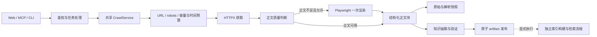

# SE-KB-Engine

SE-KB-Engine 面向技术资料与软件工程知识库，提供搜索发现、网页采集、正文清洗、结构化知识抽取、版本化存储与检索能力。可以通过桌面启动器和 Web 控制台操作，也可以由 Agent 通过 MCP 调用，或使用 REST 与离线脚本集成。

网页采集由共享应用服务执行，Web、MCP 和 CLI 使用同一套获取策略。默认质量流程完全离线，不需要模型密钥，也不调用付费模型。

## 支持范围

- Python >=3.11,<3.14；CI 配置覆盖 Windows 与 Linux。
- HTTPX 池化采集；静态响应成功但正文不足时，按策略最多回退一次 Playwright。
- 保留技术正文的 H1–H6、段落、代码缩进、表格和链接，并传入后续知识抽取。
- 结构化抽取、版本化 artifact、完整性扫描与 copy-only 迁移。
- Chroma 兼容入口与离线 BM25/vector/hybrid 检索评测。
- Bearer 角色鉴权、CSRF、SSRF 边界、限流、任务取消和关联诊断。
- 可选 Obsidian Vault 投影、冲突保护、知识关系图与 JSON Canvas 输出。

当前主要适合指定 URL 或搜索结果驱动的小批量技术资料采集。尚未提供递归链接 frontier、持久化任务自动恢复或采集后自动向量索引更新的统一闭环。选定 Tor/代理但缺少已验证传输适配器时，会明确返回 `crawl_transport_unavailable`，不会静默直连。

## 处理流程



自动批量采集检查 robots 并限制站点访问间隔；手动 URL 采集仍执行 URL 安全和容量边界。原始/解析快照使用独立采集身份，代码与表格随正文进入抽取；任务取消会阻止后续阶段与最终发布。搜索、图片分析与模型处理各自有独立预算，单页获取截止时间不代表整个知识抽取任务的总耗时。

## 目录与架构

```text
api/                 REST API（Flask，默认 8000）
web/                 Web 控制台（单独启动，默认 8000）
start_launcher.py    桌面开发启动器（默认 Web 8000 / REST 8001）
server.py            MCP stdio 服务
se_kb_app/           应用、领域、任务、抓取、artifact、抽取与检索核心
service_boundary/    鉴权、输入、URL/fetch、安全错误与审计边界
vectorizer/          现有 Chroma 分块、索引和查询适配器
scripts/             离线质量、扫描、迁移、评测和运维命令
schemas/             artifact、抽取、检索与索引 JSON Schema
deploy/              容器、Compose 与 Nginx 配置
tests/                默认断网的单元、集成、契约和安全测试
openspec/             主规格与变更历史
```

运行时依赖方向为 `入口/适配器 → application/domain ← infrastructure`。配置和拥有生命周期的资源由 `se_kb_app.composition.Application` 组装。详见 [架构说明](docs/ARCHITECTURE.md)。

## 离线快速开始

安装 [uv](https://docs.astral.sh/uv/) 后：

```powershell
uv sync --frozen --extra api --group dev
uv run python scripts/quality.py
```

质量命令执行编码/编译、锁文件漂移、安全与交付配置、文档链接、Ruff、mypy、离线检索基准及默认断网的 pytest。它不需要 API key；浏览器、真实网络、模型、Tor 与 Docker 测试默认排除。

## 服务入口

推荐本地开发使用窗口启动器。先安装桌面依赖：

```powershell
uv sync --frozen --extra api --extra desktop --group dev
```

Windows 双击根目录 `启动工作台.vbs`，或运行 `.venv\Scripts\python.exe start_launcher.py`。可一键启动 Web（8000）与 REST API（8001）、查看日志和分别重启；Windows 还需 WebView2 Runtime，详见[窗口开发启动器](docs/DEV_LAUNCHER.md)。

先参考 `.env.example` 配置服务，用进程环境或秘密管理器提供长随机密钥；示例占位值必须替换，不要提交 `.env`。搜索需要相应 provider 配置，知识抽取和语义检索可能需要模型/embedding 配置，详见[配置参考](docs/SETTINGS.md)。

| 启动方式 | Web | REST API | MCP |
| --- | --- | --- | --- |
| 桌面启动器默认 | 8000 | 8001 | 由 MCP 客户端单独启动 |
| 旧入口分别启动 | 8000 | 8000 | stdio，无 HTTP 端口 |

Web 自身的 `/api/` 用于控制台采集任务，不依赖 REST 8001；REST `/api/v1/` 主要用于检索与管理。分别启动两个旧 HTTP 入口时需要配置不同端口。

REST API（`http://127.0.0.1:8000`）：

```powershell
$env:KB_READ_KEYS='replace-with-random-read-key'
$env:KB_ADMIN_KEYS='replace-with-random-admin-key'
uv run python -m api.app
```

Web 控制台（也使用 8000，不能与 REST 同时占用同一地址）：

```powershell
uv run python start_web.py
```

MCP 是 stdio 服务，由 MCP 客户端启动，不监听 HTTP 端口：

```powershell
uv run python server.py
```

`/api/v1/live` 只表示进程响应；`/api/v1/ready` 检查必需检索能力；详细诊断在需要 admin bearer 的 `/api/v1/admin/diagnostics`。

## 爬虫配置与浏览器能力

默认采集参数如下，可通过对应环境变量调整：

| 环境变量 | 默认值 | 用途 |
| --- | --- | --- |
| `CRAWL_WORKERS` | 4 | 共享采集执行器与网络并发上限 |
| `CRAWL_PER_HOST` | 1 | 每个 hostname 的并发请求上限 |
| `CRAWL_WAITING` | 16 | 额外等待容量 |
| `CRAWL_MIN_INTERVAL` | 1 秒 | 同 hostname 请求启动的最小间隔 |
| `FETCH_TOTAL_SECONDS` | 60 秒 | 单页获取预算，包含重试与渲染 |
| `MODEL_TIMEOUT_SECONDS` | 60 秒 | 主模型单次请求超时 |

瞬态网络错误最多静态尝试三次；永久 HTTP 错误、挑战页和策略拒绝不会转交第三方或切换传输。跨 origin 重定向隔离敏感凭据，每跳进行 URL 校验并使用已验证 IP 连接；响应的原始/解压字节、重定向次数和 HTML 结构均受限。条件请求默认关闭，只有存在可复用正文快照的 opt-in 客户端才使用 304 缓存。

需要动态页面时，显式安装浏览器依赖与 Chromium：

```powershell
uv sync --frozen --extra api --extra browser --group dev
uv run --extra browser playwright install chromium
```

若还使用桌面启动器，在同步命令中同时添加 `--extra desktop`。浏览器在专属执行器内串行运行，子请求通过受控 HTTP 获取；目前不支持 POST 型页面数据请求。应用路由不能替代 OS 出口隔离，真实浏览器兼容性与资源回收需要独立验收。

资源所有权、失败状态、robots、取消、快照与回滚详见[爬虫与任务运维](docs/CRAWL_AND_JOB_OPERATIONS.md)。

## 验证证据

2026-10-16 的离线验收结果：

- 总门禁：311 项通过、1 项跳过，3 项真实浏览器用例按默认策略排除。
- 100 页本机共享采集回归：100/100 成功。
- 30 分钟本机混合场景：26,982 次操作，无非预期结果；结束时队列与活动请求归零，自有采集 worker 无残留，客户端已关闭。
- 50 个合成技术文档金标准：正文及结构指标达标；这些样本覆盖已知回归，不代表独立真实网站质量评测。

本轮没有访问真实网站、启动真实浏览器或调用付费模型；本机延迟与吞吐量不能直接外推生产性能。可复跑命令、报告原件和验证限制见[共享采集链验收](docs/CRAWL_EXECUTION_VERIFICATION.md)。

## 容器

容器默认非 root、只读根文件系统，数据/缓存/输出/日志/索引使用独立卷，密钥从启动环境注入：

```powershell
$env:KB_READ_KEYS='replace-with-random-read-key'
$env:KB_ADMIN_KEYS='replace-with-random-admin-key'
docker compose -f deploy/docker-compose.yml up --build kb-api
```

网关是显式 profile，默认只绑定回环地址的 8080；公网/TLS 必须在部署前另行配置和验证：

```powershell
docker compose -f deploy/docker-compose.yml --profile gateway up --build
```

参见 [容器与回滚](docs/CONTAINER_OPERATIONS.md)。本项目不会自动公开部署、删除旧索引或迁移唯一数据副本。

## 网络、费用与数据写入

- 默认质量和检索评测：无网络、无模型费用，只写临时目录或明确的报告目标。
- 搜索、抓取、浏览器、Tor 和真实模型测试：可能访问外网；LLM/embedding 可能收费，必须显式选择对应 pytest marker 或脚本。
- artifact 迁移默认 dry-run；`--execute` 只允许在审核了精确源/目标后使用。
- 索引构建默认 dry-run，新索引验证后才可原子切换，旧索引不会自动删除。

详细说明见 [测试分层](docs/TESTING.md)、[安全边界](docs/SECURITY.md)、[artifact 生命周期](docs/ARTIFACT_LIFECYCLE.md) 和 [检索评测](docs/RETRIEVAL_EVALUATION.md)。

## 运维与发布

- [配置参考](docs/SETTINGS.md)
- [爬虫与任务运维](docs/CRAWL_AND_JOB_OPERATIONS.md)
- [爬虫实施与验收](docs/CRAWL_EXECUTION_VERIFICATION.md)
- [Obsidian Vault 集成](docs/OBSIDIAN_INTEGRATION.md)
- [REST/MCP 契约与副作用](docs/INTERFACES.md)
- [故障处理手册](docs/RUNBOOKS.md)
- [发布流程](docs/RELEASE_PROCESS.md)
- [供应链分诊](docs/SUPPLY_CHAIN_TRIAGE.md)

版本的唯一来源是 `pyproject.toml` 中的 `[project].version`。发布前必须完成 `docs/RELEASE_READINESS.md` 的证据清单。

## License

MIT License
