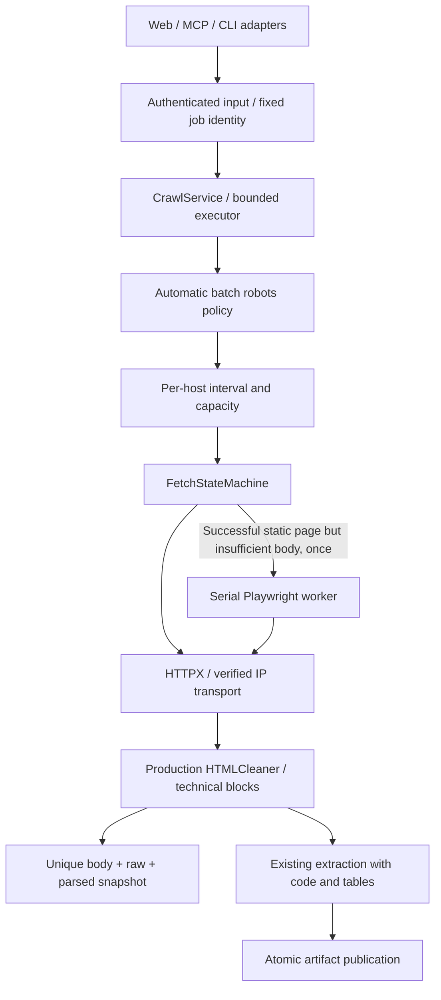

# Crawl and job operations

## Current production wiring (2026-10-16)

`unify-crawl-execution` connects Web, MCP and `scripts/run_web_crawl.py` to
`CrawlService` through the compatibility `WebpageCrawler` facade. Composition
lazily owns the service; standalone callers use a process singleton with atexit
close. The facade never closes an injected/shared service.



Search providers remain discovery adapters, not recursive crawlers. Provider
search and model operations have separate bounded timeouts; the per-page
deadline starts at acquisition, not at the beginning of a whole search/model
job. REST retrieval APIs remain separate from Web crawl `/api/` endpoints.
No sitemap/frontier, automatic vector reindexing or durable job resume is added.

### Configuration

`AppSettings.from_sources()` accepts a JSON `crawl` object with `workers`,
`per_host`, `waiting`, `min_interval`, `proxy_url`; environment values override it.

| Setting | Default | Meaning |
| --- | --- | --- |
| `CRAWL_WORKERS` | 4 | Executor workers and concurrent network operations; valid 1–16 |
| `CRAWL_PER_HOST` | 1 | Concurrent operations per hostname, no greater than workers |
| `CRAWL_WAITING` | 16 | Additional waiting capacity; valid 0–256 |
| `CRAWL_MIN_INTERVAL` | 1 second | Minimum same-host request start interval; valid 0–60 |
| `FETCH_TOTAL_SECONDS` | 60 | Page acquisition budget including validation wait, retries, capacity and rendering |
| `FETCH_CONNECT_SECONDS` | 10 | Connection stage maximum, clipped by remaining page budget |
| `FETCH_READ_SECONDS` / `FETCH_WRITE_SECONDS` | 20 / 20 | Per-operation maxima, clipped by remaining budget |
| `FETCH_POOL_SECONDS` | 5 | Connection pool wait bound |
| `FETCH_MAX_REDIRECTS` | 5 | HTTP redirect limit |
| `FETCH_MAX_COMPRESSED_BYTES` | 8 MiB | Actual raw/compressed response bound, including chunked responses |
| `FETCH_MAX_DECOMPRESSED_BYTES` | 16 MiB | Incrementally decoded body bound |
| `FETCH_MAX_IMAGE_PIXELS` | 40,000,000 | Image decoding pixel bound |
| `MODEL_TIMEOUT_SECONDS` | 60 | Main composed model request timeout; no SDK automatic retries |
| `ENABLE_NEAR_CONTENT_DEDUP` | false | Optional approximate-content rejection; exact v2 hashes remain enabled |

Browser execution is serialized with 16 waiting submissions. A rendered page
has at most 100 routed requests and a shared aggregate decoded-byte/deadline
budget. HTML parsing additionally caps tags at 50,000 and nesting depth at 128.
Static acquisition attempts at most three times. Only transient errors retry;
long `Retry-After` values are not shortened into early requests. Permanent HTTP
errors, policy failures and exhausted transport failures never invoke rendering.
Only a successful but insufficient static page may render, at most once.
These are conservative defaults, not measured production-optimal values.

### Transport and credentials

- Clients ignore ambient HTTP proxy variables and use explicit verified
  transports. Every hop validates the target; the transport connects to a
  validated IP while retaining the original HTTP Host and TLS server name.
  This uses one characterized private HTTPX/httpcore backend seam: dependency
  upgrades must rerun connection/TLS/deadline tests.
- Cross-origin redirects discard non-benign headers, including Authorization,
  Cookie and custom credential headers. Shared clients do not retain response
  cookies between jobs. Target/image/model credentials are isolated.
- Selected `USE_TOR=true` or `PROXY_URL` currently returns
  `crawl_transport_unavailable`: no verified Tor/proxy adapter exists, even if
  the legacy Tor controller can start. There is no silent direct fallback.
- Third-party URL forwarding through r.jina.ai and default simulated human
  dwell are removed. Sensitive URL queries are not delegated.
- Conditional requests are **off by default**. Opt-in fetchers send validators
  only with a usable document and reuse it on 304. Metadata has a 128-entry,
  300-second bound and cached-body estimates have a 16 MiB cap. Personalized,
  private and no-store responses are not shared. Unsolicited 304 fails clearly.

Playwright remains optional. Contexts block Service Workers, downloads and
WebSockets. Allowed GET resources are fulfilled through verified HTTP; private
subrequests and interception setup failure fail closed. POST-based application
data and some browser-native networking are intentionally unsupported.
Application routing is **not OS-level egress isolation**. Real-browser
compatibility, WebRTC/background egress and process-tree cleanup still require
separately opted-in acceptance and deployment network controls.
An optional loopback-only dynamic/static/timeout acceptance file is
`tests/test_crawl_browser_acceptance.py`, marked `browser` and excluded by
default. After explicitly provisioning the browser runtime, select it using
`python -m pytest tests/test_crawl_browser_acceptance.py --override-ini=addopts= -m browser -q`.

### Site rules, identity and publication

Automatic search/CLI batches consult robots before target operations, including
redirect origins/browser resources. Manual URL acquisition is an operator
action and does not automatically consult robots; network safety and hostname
limits still apply. Robots 404/410 allows, 401/403 denies; HTML challenges,
cross-origin redirects and unknown/network failures return `robots_unknown`.
Rules cache for 300 seconds/128 origins. Crawl-delay/request-rate can only
increase the local interval. Access restrictions are not bypassed.

URL identities preserve path case, semantic parameters and repeated query order;
only scheme/host/default port/fragment and a small tracking allowlist normalize.
Requested/final URLs and dedup keys have separate roles. Old records are kept.
New `v2:` content hashes preserve operators and indentation. Optional approximate
matching is limited to 128 recent candidates with 2,048-character fingerprints.

Facade captures use UUIDs and atomic files in `data/raw`, `data/parsed`, with a
manifest published last in `data/crawl_snapshots`. `.body` is decompressed
acquired bytes (or UTF-8 rendered DOM), **not a compressed wire archive**.
Readers use the manifest to distinguish completed captures from partial
diagnostics. Knowledge artifacts stage outside the discoverable artifact root
and publish by a unique directory rename. Failed/cancelled staging may remain
under `se_kb/artifact_staging` for inspection. Disk retention is an operator task;
existing captures/databases are never automatically rewritten or deleted.
MCP compatibility JSON/Markdown exports also use a UUID and atomic file writes;
the internal knowledge save calls business code rather than a protected MCP tool.
Legacy knowledge category JSON and its summary use atomic file replacement.

### Cancellation and lifecycle limits

Workers bind immutable job IDs. Late logs stay with their original job and
terminal states cannot be overwritten. Web JSON, `X-Job-ID` and `Location`
remain compatible. Cancellation checks occur at queue, fetch, backoff, parse,
model, validation and publication boundaries. A publication already holding the
token lock completes before cancel acknowledges; no later publication starts.

Native resolver/model calls already running cannot be forcibly killed. Model
calls retain explicit SDK timeouts. DNS validation has a process-scoped executor
(four workers, 20 admitted calls): caller waits respect the deadline, while
native resolver calls may finish later. Its idle process threads are not
per-job leaks. Shutdown stops admission, cancels work, waits a bounded grace and
closes owned resources; native work still completing uses its own budget.

Executors reclaim completed futures. History defaults to 256 records/one-hour
TTL/200 events per job; live workers pin their records, including after cancel,
then release them for pruning. Restored nonterminal snapshots are interrupted;
there is no persistent queue or automatic resume.

### Acceptance and rollback

```powershell
$env:SE_KB_SKIP_DOTENV='1'
$env:NO_PROXY='localhost,127.0.0.1,::1'
.\.venv\Scripts\python.exe scripts\quality.py
.\.venv\Scripts\python.exe scripts\run_offline_crawl_soak.py --requests 100 --report .tmp/crawl-100.json
.\.venv\Scripts\python.exe scripts\run_offline_crawl_soak.py --seconds 1800 --report .tmp/crawl-1800.json
openspec validate unify-crawl-execution --strict
```

Restricted Windows localhost/atomic rename checks may need normal host
permissions; do not disable authentication or URL policy to pass. See
[execution verification](CRAWL_EXECUTION_VERIFICATION.md). Synthetic local gold
fixtures calculate production precision/recall/structure, but are not independent
human-labelled real-site evidence. No browser or paid-model test runs by default.

Rollback requires reviewing only this change's hunks against the preserved
code-only preimplementation snapshot; unrelated work is already uncommitted.
Keep new capture batches and old user data. Do not restore an entire dirty
checkout or re-enable credential leaks/third-party forwarding. Adapter rollbacks
must retain the fixed network boundary. Static-only operation can be selected
explicitly if browser validation is unavailable. No bulk data migration is needed.

## Historical operating notes (superseded where different)

The following notes and September report predate the production integration.
Their timings are not a before/after comparison with the October implementation.

## Fetch policy

Each URL follows a finite path: validate, static HTTP, classify, optional typed retry, and at most
one rendered fallback. Acceptable static content completes immediately. Policy failures,
unsupported media, login walls, and challenges are terminal; the crawler does not attempt CAPTCHA
bypass or silently switch between Tor, proxy, and direct transports.

HTTP clients are pooled and explicitly closed. Connect, pool, read, write, total-operation,
compressed-body, decompressed-body, redirect, and image-pixel bounds are enforced. Retryable
statuses are 408, 425, 429, and 5xx. Transport timeouts/disconnects are transient. Backoff is
exponential with bounded jitter; a valid `Retry-After` value takes precedence. Conditional ETag and
Last-Modified metadata and canonical/final URLs are recorded without modifying submitted URLs.

Default capacity is configured by the composition layer. Producers must use `CrawlCapacity`, which
enforces global, per-host, and admission limits. A full admission bound returns
`crawl_capacity_exceeded`; it never creates an unbounded thread or queue entry.

## Jobs and cancellation

Long work is submitted with an immutable parameter snapshot and stable job ID. States are `queued`,
`running`, `succeeded`, `failed`, `cancelled`, and `interrupted`. Terminal states never change; late
worker reports are retained as bounded diagnostic events. The Web compatibility response preserves
its existing JSON body and exposes the new ID in `X-Job-ID` and `Location` headers. Status accepts a
job ID, and `/api/jobs/<job_id>/cancel` requests cooperative cancellation.

Workers call the cancellation token at queue, fetch, browser/model boundary, extraction, validation,
and publication checkpoints. Shutdown stops admission, cancels non-terminal jobs, waits only for the
configured deadline, and closes owned clients, contexts, Tor processes, and subscriptions. Restored
non-terminal snapshots become `interrupted`; automatic resume is intentionally not selected.

## Validation

The default suite is offline and uses the loopback fixture server. Run the bounded soak with:

```powershell
.\.venv\Scripts\python.exe scripts\run_offline_crawl_soak.py
```

The report includes throughput, p95/mean latency, peak Python memory, queue high-water mark, final
queue/active counts, client closure, and error classes. Live-network checks are opt-in only and must
use an explicit target, conservative request count, and operator-approved rate limit.

The checked-in Windows/Python 3.13 baseline is
`docs/baseline/crawl-soak-2026-09-15.json`: 100/100 successes, no classified errors, 50.64 requests/s,
31.34 ms p95, 10,150,553 peak traced bytes, and zero final queued or active operations.
